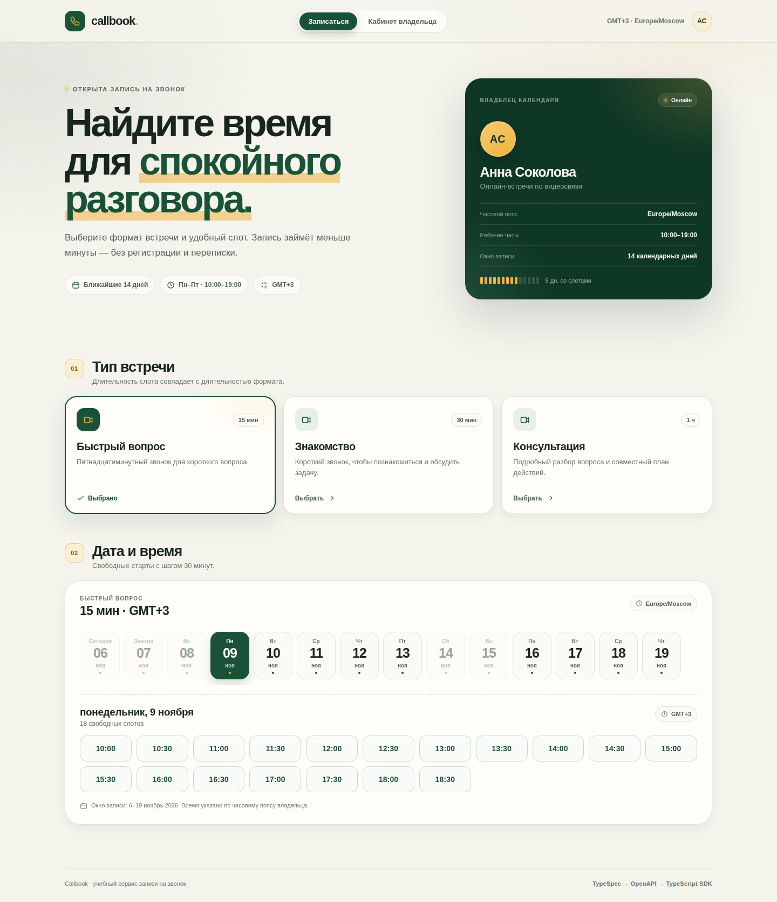
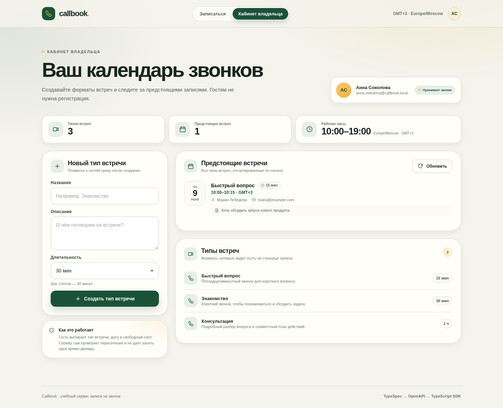

# Календарь звонков

[](https://github.com/ElikCandy2026/ai-for-developers-project-386/actions)

Сервис для бронирования календаря, разработанный совместно с ИИ.

Учебный проект Хекслета: https://ru.hexlet.io/programs/ai-for-developers
Как это должно работать: https://files.hexlet.app/a/2ipc5m

Небольшой законченный сервис бронирования времени по мотивам [Cal.com](https://cal.com/):
владелец публикует типы встреч и свободные слоты, гость без регистрации выбирает
формат, дату и время.

Проект сделан contract-first: источник истины — TypeSpec-контракт, из него
генерируются OpenAPI-спецификация, серверные интерфейсы/модели Spring и
TypeScript SDK, который использует фронтенд.





## Сценарий: от типа встречи до записи у владельца

Это основной пользовательский путь приложения.

### Владелец создаёт тип встречи

1. Открыть приложение и перейти во вкладку **«Кабинет владельца»**.
2. В блоке **«Новый тип встречи»** заполнить название, например `Знакомство`,
   описание и выбрать длительность `30 минут`.
3. Нажать **«Создать тип встречи»**. Тип сразу появляется в списке типов и на
   странице гостя.

### Гость выбирает слот и записывается

1. Перейти во вкладку **«Записаться»**.
2. Выбрать тип встречи `Знакомство`. Под календарём появится длительность слота
   `30 минут`.
3. В календаре на 14 дней выбрать день со свободными слотами.
4. Нажать на время, например `10:00` (время владельца, `Europe/Moscow`).
5. В диалоге заполнить имя, email и при желании комментарий.
6. Нажать **«Записаться»**. Появится подтверждение с типом встречи, датой и
   временем.

### Владелец видит запись

1. Вернуться во вкладку **«Кабинет владельца»** (страница перезагружает список
   записей при открытии; для обновления вручную есть кнопка **«Обновить»**).
2. В блоке **«Предстоящие встречи»** появляется запись: дата, время, тип встречи,
   имя гостя, email и комментарий.
3. Занятое время исчезает из календаря гостя. При попытке занять его повторно —
   в том числе встречей другого типа — сервер вернёт `409 Conflict`.

В референсном Cal.com путь аналогичен: создать event type → открыть публичную
страницу → выбрать дату и слот → заполнить данные гостя → увидеть booking в
календаре владельца. Регистрация, внешние календари и уведомления в этом проекте
намеренно не реализованы.

## Правила записи

Правила заданы в TypeSpec-контракте (`contract/main.tsp`), отдаются клиенту через
`GET /api/owner` и проверяются на сервере.

| Правило | Значение |
| --- | --- |
| Владелец | один, задан заранее: Анна Соколова |
| Часовой пояс | `Europe/Moscow` (UTC+3, без перехода на летнее время) |
| Рабочие дни | понедельник–пятница |
| Рабочие часы | 10:00–19:00 по времени владельца |
| Окно записи | 14 календарных дней, начиная с сегодняшнего дня по времени владельца |
| Сдвиг окна | каждый календарный день в 00:00 по времени владельца |
| Шаг доступных стартов | 30 минут от начала рабочего дня |
| Длительность слота | равна длительности выбранного типа встречи |
| Допустимая длительность | 15–240 минут, кратно 15 |
| Минимальный запас до встречи | 0 минут (слот должен быть в будущем) |
| Пересечения | запрещены для всех типов встреч; частичное наложение тоже запрещено |
| Смежные встречи | разрешены: следующая может начаться ровно в момент окончания предыдущей |
| Одновременные запросы | два запроса на один слот не могут оба завершиться успешно |

Дни окна возвращаются все 14: выходные и дни без слотов приходят с пустым
массивом `slots`, чтобы интерфейс мог показать полный календарь.

## Стек

- **Контракт:** TypeSpec 1.17 → OpenAPI 3.0.0 (`@typespec/openapi3`).
- **Backend:** Java 21, Spring Boot 3.5.16, Spring Web MVC, Spring JDBC, SQLite
  (`sqlite-jdbc`), Maven.
- **Frontend:** TypeScript, React 19, Vite. Клиентский SDK генерируется из OpenAPI
  через `@hey-api/openapi-ts` — для TypeScript есть готовый генератор клиента.
- **Сборка:** Node 22 (зафиксирован в `.nvmrc` и `engines.node`) и Java 21.
  Vite собирает фронтенд в `frontend/dist`, Maven упаковывает его в jar.
- **Хранилище:** SQLite, файл `./data/call-booking.db` по умолчанию.

Серверные интерфейсы и DTO не написаны руками: OpenAPI Generator (`spring`,
`interfaceOnly`) генерирует `*Api` и модели в `backend/target/generated-sources/openapi`
на этапе `generate-sources`. Контроллер реализует сгенерированные интерфейсы.
Клиентский SDK лежит в `frontend/src/api/generated` и тоже генерируется, а не
пишется вручную.

## Структура проекта

```
.
├── contract/                     TypeSpec-контракт
│   ├── main.tsp                  источник истины API
│   ├── tspconfig.yaml            эмиттер OpenAPI
│   └── tsp-output/openapi/
│       └── openapi.yaml          сгенерированная спецификация (в репозитории)
├── backend/                      Spring Boot + SQLite
│   ├── pom.xml                   генерация серверных интерфейсов и упаковка frontend
│   └── src/
│       ├── main/java/com/callbooking/
│       │   ├── api/              контроллер и обработка ошибок
│       │   ├── config/           настройки, SQLite, демо-данные
│       │   ├── domain/           правила слотов и бронирования
│       │   └── persistence/      JDBC-репозитории
│       ├── main/resources/
│       │   ├── application.yml
│       │   └── schema.sql
│       └── test/                 11 интеграционных тестов
├── frontend/                     React + TypeScript + Vite
│   ├── openapi-ts.config.ts      генерация SDK
│   ├── dist/                     собранная статика (не в git)
│   └── src/
│       ├── api/generated/        сгенерированный SDK (в репозитории)
│       ├── components/           гость, кабинет владельца, диалог записи
│       └── lib/                  форматирование дат и ошибок
├── .github/workflows/ci.yml      make install && make verify
├── .nvmrc                        версия Node для генерации и сборки
├── docs/                         скриншоты
├── Makefile
└── README.md
```

## API

Все моменты времени в запросах и ответах — UTC ISO 8601. Локальные даты
календаря — даты в часовом поясе владельца.

| Метод | Маршрут | Назначение |
| --- | --- | --- |
| `GET` | `/api/owner` | владелец и правила записи |
| `GET` | `/api/meeting-types` | список типов встреч |
| `POST` | `/api/meeting-types` | создать тип встречи |
| `GET` | `/api/meeting-types/{id}` | тип встречи по id |
| `GET` | `/api/meeting-types/{id}/availability` | свободные слоты на актуальное 14-дневное окно |
| `POST` | `/api/bookings` | записаться на слот |
| `GET` | `/api/bookings?includePast=false` | предстоящие встречи всех типов |

Ошибки возвращаются в едином JSON-виде:

```json
{
  "code": "SLOT_TAKEN",
  "message": "Это время уже занято другой встречей. Выберите другой слот."
}
```

Коды ошибок: `VALIDATION_FAILED`, `MEETING_TYPE_NOT_FOUND`, `INVALID_DURATION`,
`SLOT_UNAVAILABLE`, `SLOT_TAKEN`.

## Контракт и кодогенерация

TypeSpec-контракт: [`contract/main.tsp`](contract/main.tsp).
Сгенерированная спецификация: [`contract/tsp-output/openapi/openapi.yaml`](contract/tsp-output/openapi/openapi.yaml).

```bash
# Пересобрать OpenAPI из TypeSpec
cd contract
npm ci
npm run compile

# Пересобрать TypeScript SDK из OpenAPI
cd ../frontend
npm ci
npm run generate:api

# Серверные интерфейсы и модели генерируются Maven-плагином
cd ../backend
mvn generate-sources
```

Генерация клиента проверена: `@hey-api/openapi-ts` создаёт типизированные функции
`getOwner`, `listMeetingTypes`, `getAvailability`, `createBooking` и модели
`Owner`, `MeetingType`, `Availability`, `Booking` в `frontend/src/api/generated`.

TypeSpec — единственный источник истины. OpenAPI и TypeScript SDK коммитятся в
репозиторий, поэтому backend собирается без Node, а frontend — без TypeSpec.
`tsp compile` запускается с `--warn-as-error`. Свежесть сгенерированных файлов
проверяет `make check-generated`: он перегенерирует контракт и SDK и падает, если
в `contract/tsp-output` или `frontend/src/api/generated` появились изменённые,
новые или удалённые файлы. Посторонние изменения он игнорирует.

## Установка

Нужны JDK 21, Maven 3.9+, Node.js 22 и npm. Версия Node зафиксирована в `.nvmrc`
(`nvm use`), а также в `engines.node` пакетов `contract` и `frontend`.

```bash
git clone https://github.com/ElikCandy2026/ai-for-developers-project-386.git
cd ai-for-developers-project-386
make install
```

`make install` устанавливает зависимости контракта и фронтенда. Зависимости
backend Maven скачает при сборке.

## Использование

### Быстрый запуск (всё в одном jar)

```bash
make build
make run
```

`make build` перегенерирует OpenAPI и SDK, собирает фронтенд в `frontend/dist` и
упаковывает его Maven-ом в jar (`target/classes/static`). `make run` сначала
выполняет ту же сборку, затем запускает приложение. Открыть
<http://localhost:8080> — Spring Boot раздаёт фронтенд из jar.

Без `make`:

```bash
cd contract && npm ci && npm run compile && cd ..
cd frontend && npm ci && npm run generate:api && npm run build && cd ..
cd backend && mvn -DskipTests package
java -jar target/call-booking-1.0.0.jar
```

Собранная статика не хранится в git: `frontend/dist` и `backend/target`
игнорируются, а `backend/src/main/resources/static` создаётся только в выводе
сборки.

При первом запуске база создаётся автоматически. По умолчанию добавляются три
демонстрационных типа встреч, если таблица типов пуста. Отключить:

```bash
SEED_DEMO_DATA=false java -jar target/call-booking-1.0.0.jar
```

Переменные окружения:

| Переменная | По умолчанию | Назначение |
| --- | --- | --- |
| `PORT` | `8080` | порт сервера |
| `DB_PATH` | `./data/call-booking.db` | файл SQLite |
| `SEED_DEMO_DATA` | `true` | демо-типы при пустой базе |
| `VITE_API_BASE_URL` | пусто | адрес API для SDK; по умолчанию same-origin |

### Режим разработки

Терминал 1:

```bash
make dev-backend
```

Терминал 2:

```bash
make dev-frontend
```

Vite откроется на <http://localhost:5173> и проксирует `/api` на `:8080`.

## Тесты

```bash
cd backend
mvn test
```

11 интеграционных тестов поднимают приложение на случайном порту и используют
временную SQLite-базу. Проверяются:

- правила владельца и окно в 14 календарных дней;
- сетка слотов, рабочие часы, выходные и длительность слота;
- создание типа встречи и валидация длительности;
- успешная запись и исчезновение слота из календаря;
- частичное пересечение разных типов и разрешённая смежная запись;
- отказ для слота вне окна и вне шага сетки;
- валидация имени и email гостя;
- `404` для неизвестного типа;
- **10 одновременных запросов на один слот, в том числе от разных типов встреч:
  ровно один `201`, остальные `409`.**

Полная проверка контракта, генерации, фронтенда и тестов:

```bash
make verify
```

`make verify` — единственная точка входа для проверки. Он выполняет
`make check-generated` (свежесть OpenAPI/SDK), собирает фронтенд и запускает
backend-тесты. CI использует Node 22 и Java 21 и запускает ту же команду
(`make install && make verify`), поэтому «зелено локально» означает «зелено в CI».

| Команда | Что делает |
| --- | --- |
| `make install` | `npm ci` в `contract` и `frontend` |
| `make generate` | TypeSpec → OpenAPI → TypeScript SDK |
| `make check-generated` | падает при расхождении OpenAPI/SDK с контрактом |
| `make frontend` | сборка фронтенда в `frontend/dist` |
| `make test` | backend-тесты (без сборки фронтенда) |
| `make build` | генерация, фронтенд и jar с фронтендом внутри |
| `make verify` | `check-generated` + сборка фронтенда + тесты |
| `make run` | сборка и запуск приложения |
| `make clean` | удаляет `backend/target` и `frontend/dist` |

## Как обеспечена защита от двойной записи

Используются три уровня:

1. **Сериализация внутри приложения** — `ReentrantLock` вокруг проверки и вставки
   бронирования; транзакция коммитится до освобождения блокировки.
2. **Транзакционная проверка пересечения** — перед вставкой выполняется запрос
   `NEW.start < existing.end AND NEW.end > existing.start`.
3. **SQLite-триггер** `trg_bookings_prevent_overlap` — `BEFORE INSERT` прерывает
   вставку с `booking_overlap`, если интервал пересекается с уже существующим.
   Это защищает и при нескольких экземплярах приложения. SQLite сериализует
   писателей, включены WAL и `busy_timeout`.

Смежные интервалы не пересекаются: `10:00–11:00` и `11:00–11:30` допустимы,
`10:00–11:00` и `10:30–11:00` — нет.

## Ограничения

- Нет авторизации и личных кабинетов: владелец один и задан конфигурацией.
- Нет интеграций с внешними календарями, email/SMS-уведомлений и видеозвонков.
- Нет отмены и переноса записи.
- Приложение рассчитано на один экземпляр; SQLite-триггер — дополнительная
  защита, но не замена распределённой блокировке при горизонтальном
  масштабировании.

---

<details>
<summary>Автоматические тесты Хекслета</summary>

Тесты запускаются на каждый коммит. За запуск отвечает файл `.github/workflows/hexlet-check.yml` — не удаляйте и не переименовывайте ни его, ни репозиторий.

</details>

## О Хекслете

[Хекслет](https://ru.hexlet.io/) — школа программирования: авторские программы обучения с практикой, поддержкой наставников и реальными проектами, которые остаются в резюме. Этот репозиторий — один из таких проектов.
